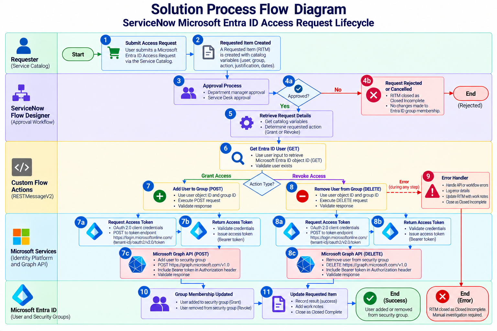

# Solution Architecture

## ServiceNow Microsoft Entra ID Access Management

### Solution Architecture Diagram

The diagram illustrates the end-to-end integration between ServiceNow and Microsoft Entra ID through Microsoft Graph API.

The architecture consists of two primary environments:

- **ServiceNow Environment:** Handles access request submission, approval processing, workflow orchestration, custom REST integration actions, and Requested Item lifecycle management.
- **Microsoft Environment:** Provides OAuth 2.0 application authentication, Microsoft Graph API endpoints, user identity information, and security group membership management.

### Integration Communication Sequence

1. **Request Submission:** A requester submits a Microsoft Entra ID Access Request through the ServiceNow Service Catalog.

2. **Approval Processing:** ServiceNow Flow Designer evaluates the approval decision. Approved requests proceed to automated processing, while rejected requests are closed without changing group membership.

3. **Custom Action Execution:** Flow Designer invokes the appropriate custom action, implemented using server-side JavaScript and `sn_ws.RESTMessageV2`.

4. **OAuth 2.0 Authentication:** The ServiceNow REST integration obtains an access token from the Microsoft identity platform using the OAuth 2.0 client credentials grant.

5. **Access Token Response:** Microsoft identity services validate the application credentials and permissions before issuing an access token.

6. **Microsoft Graph API Execution:** ServiceNow uses the access token to execute the appropriate Microsoft Graph operation:
   - GET: Retrieve the target user's Microsoft Entra ID object ID.
   - POST: Add the user to the selected security group.
   - DELETE: Remove the user from the selected security group.

7. **Response Processing:** The custom action validates the Microsoft Graph API response. Successful operations allow the workflow to close the Requested Item as Closed Complete.

8. **Exception Handling:** If a workflow execution error occurs, the configured Error Handler updates the Requested Item to Closed Incomplete and records work notes requiring manual investigation.

This architecture demonstrates approval-controlled identity management automation, application-based authentication, REST API integration, and request traceability.

## Architecture Overview

The solution integrates ServiceNow with Microsoft Entra ID through Microsoft Graph API to automate user access provisioning and revocation.

### Core Components

1. **ServiceNow Service Catalog:** Provides the Microsoft Entra ID Access Request catalog item for submitting access requests.
2. **ServiceNow Flow Designer:** Orchestrates approval decisions, user lookup, access provisioning, revocation, and request closure.
3. **Custom Flow Actions:** Execute Microsoft Graph API operations using ServiceNow RESTMessageV2.
4. **OAuth 2.0 Authentication:** Uses the client credentials grant to authenticate ServiceNow with Microsoft identity services.
5. **Microsoft Graph API:** Provides access to Microsoft Entra ID user and group membership operations.
6. **Microsoft Entra ID:** Maintains the user identities and security group memberships.
7. **Error Handler:** Handles workflow execution failures and updates affected requests for investigation.

## High-Level Process

1. A requester submits an access request through the ServiceNow Service Catalog.
2. The request enters the approval workflow.
3. If rejected, the request closes as incomplete without modifying group membership.
4. If approved, the workflow retrieves the catalog variables and resolves the target user's Entra ID object ID.
5. Based on the requested action, the workflow adds or removes the user from the selected Entra ID group through the Microsoft Graph API.
6. Successful operations close the requested item as complete.
7. Workflow execution failures invoke the error handler, which closes the requested item as incomplete and records investigation notes.

## Security Considerations

The integration uses OAuth 2.0 client credentials authentication. Authentication secrets and access tokens were not included in the public repository.

Approval controls restrict automated access changes to approved requests.

## Solution Process Flow Diagram

The process flow diagram illustrates the complete lifecycle of a Microsoft Entra ID access request, from Service Catalog submission through approval, automated identity management, and final Requested Item closure.

### Workflow Execution Sequence

1. **Access Request Submission:** A requester submits the Microsoft Entra ID Access Request catalog item, specifying the target user, security group, requested action, and business justification.

2. **Requested Item Creation:** ServiceNow creates a Requested Item (RITM) containing the submitted catalog variables.

3. **Approval Processing:** Flow Designer evaluates the configured approval requirements before proceeding with automated access management.

4. **Approval Decision:**
   - **Approved:** The workflow continues to retrieve the request details.
   - **Rejected or Cancelled:** The workflow closes the RITM as Closed Incomplete without executing Microsoft Graph group membership changes.

5. **Retrieve Request Details:** Flow Designer retrieves the catalog variables, including the target user's email address, selected Microsoft Entra ID group, and requested access action.

6. **Get Entra ID User (GET):** A custom Flow Designer action invokes Microsoft Graph API through `sn_ws.RESTMessageV2` to retrieve the target user's Microsoft Entra ID object ID.

7. **Grant Access (POST):** For approved provisioning requests, the workflow invokes the custom Add User to Entra ID Group action, which sends a Microsoft Graph POST request to add the user to the selected security group.

8. **Revoke Access (DELETE):** For approved revocation requests, the workflow invokes the custom Remove User from Entra ID Group action, which sends a Microsoft Graph DELETE request to remove the user from the selected security group.

9. **Error Handling:** If a workflow execution error occurs, the configured Error Handler records investigation notes and closes the Requested Item as Closed Incomplete.

10. **Group Membership Update:** Microsoft Entra ID processes successful Microsoft Graph membership operations, adding or removing the target user from the selected security group.

11. **Requested Item Closure:** Following successful processing, Flow Designer records the outcome in the work notes and automatically closes the RITM as Closed Complete.

### Workflow Outcomes

| Scenario | Microsoft Graph Operation | Final RITM State |
|---|---|---|
| Approved Grant Access | GET and POST | Closed Complete |
| Approved Revoke Access | GET and DELETE | Closed Complete |
| Rejected or Cancelled Request | No group membership operation | Closed Incomplete |
| Workflow Execution Error | Operation unsuccessful or interrupted | Closed Incomplete |

### Workflow Governance and Controls

The solution incorporates approval-based access governance, OAuth 2.0 client credentials authentication, Microsoft Graph API response validation, automated Requested Item lifecycle updates, and workflow-level exception handling.

Successful requests are recorded as Closed Complete, while rejected requests and execution failures are recorded as Closed Incomplete with appropriate work notes.

These controls support consistent identity management, traceability, and operational accountability.

